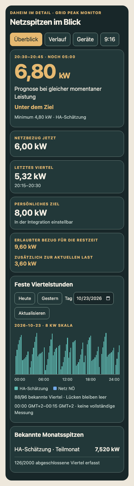

# Grid Peak Monitor

**Netzspitzen im Blick: eine schlanke Home-Assistant-Integration mit direkt verfügbarer Netzspitzen-Seite und optionaler Dashboard-Karte.**

**Testversion 0.1.0-alpha.7 für einen kleinen Testkreis.** Von Daheim im Detail, geprüft mit Home Assistant **2026.10.2 und 2026.10.4**. Die korrigierte Fassung ist für einen Test mit 1–2 Personen vorbereitet. Noch kein stabiles Release und kein HACS-Standardpaket.

➡️ **[Schnell installieren](docs/SCHNELLSTART.md)** · [Netzbetreiberdaten ergänzen – Beispiel Netz NÖ](docs/NETZBETREIBERDATEN.md) · [Ausführliche Tester-Anleitung](docs/TESTER.md) · [Release-Notizen](RELEASE_NOTES.md)

Du wählst zwei bereits vorhandene Sensoren aus: aktuelle Netzleistung und fortlaufend gezählte Bezugsenergie. Die Integration berechnet daraus eine Prognose für die laufende feste Viertelstunde und archiviert abgeschlossene Intervalle. Sie steuert keine Geräte und benötigt keine Zugangsdaten, Cloud oder externen Bibliotheken.



## Was enthalten ist

- Einrichtung über **Einstellungen → Geräte & Dienste → Integration hinzufügen → Grid Peak Monitor**.
- Messquellen nachträglich über **⋮ → Neu konfigurieren** ändern. Monitor-Entitäten bleiben erhalten; neue Quellen starten mit frischem Verlauf und lokaler Sicherung des bisherigen Archivs.
- Neun Sensoren, darunter Prognose, unvermeidbares Minimum, letzte Viertelstunde, bekannte lokale Monatsspitze und verbleibender Leistungsspielraum.
- Persönliches Leistungsziel direkt in der Karte ändern und speichern; der Wert bleibt über Neustarts erhalten.
- Eigene Netzspitzen-Seite in der Seitenleiste, Mehrmonitorauswahl und zusätzlich optionale Karte mit Überblick, Tagesverlauf, lokalen Monatsmaxima, Geräte-Momentanwerten und 9:16-Ansicht. Kein `button-card` erforderlich.
- Lokales Archiv für etwa 93 Tage. Neustarts erhalten bekannte Intervallgrenzen; längere Lücken bleiben unvollständig.
- Sommer-/Winterzeit: 92, 96 oder 100 Viertelstunden pro Tag, unterschieden über UTC-Zeitstempel.
- Optional: vorhandene Netz-NÖ-Portalwerte in der Karte anzeigen. Ein Portal-Importer ist **nicht enthalten**.

## Voraussetzungen

- Für diese Alpha: Home Assistant **2026.10.2 und 2026.10.4**. Ältere Versionen sind noch nicht geprüft.
- Ein Leistungssensor in `W` oder `kW`. Bei vorzeichenbehafteter Netzleistung lässt sich „Bezug positiv/negativ“ auswählen.
- Ein **fortlaufender Bezugsenergiezähler** in `Wh`, `kWh` oder `MWh`, mit `state_class: total` oder `total_increasing`.
- Der Energiezähler zählt ausschließlich Import aus dem Netz. Ein saldierter Zähler, Haushaltsverbrauch oder PV-Ertrag passt nicht dazu. Tages-/Monatszähler mit regelmäßigen Rücksetzungen verursachen Datenlücken.
- Die Netzleistung muss regelmäßig berichten; standardmäßig gelten 120 Sekunden als Höchstalter. Für Energiezähler, die nur bei Änderungen berichten, lässt sich die bekannte Zählerauflösung einstellen: beispielsweise `0,01 kWh` für 10 Wh. Mit durchgehend frischer Netzleistung darf der Zähler bei Versorgung durch PV/Hausakku oder sehr kleinem Bezug unverändert bleiben. Kurze getrennte Regelausschläge summieren sich nicht zu einem Stillstandsalarm; anhaltender Bezug und große bestätigte Pulse werden weiter geprüft. Die Prüfung erkennt weiterhin fehlende Meldungen und Stillstand trotz Bezug. [Frischeprüfung und Grenzen](docs/FRISCHEPRUEFUNG.md). Der Standardwert `0` behält die strenge Meldefrist bei.

## Installation

Der [Schnellstart](docs/SCHNELLSTART.md) führt durch vier Schritte: Backup und Installation, HA-Neustart und Integration hinzufügen, zwei Messquellen plus Richtung/Ziel bestätigen, **Netzspitzen** in der Seitenleiste öffnen. Für die erste Nutzung sind weder Dashboardbearbeitung noch eine manuell eingetragene JavaScript-Ressource erforderlich.

Mit vorhandenem HACS kann ein öffentlich zugänglicher, passend strukturierter Projektstand als benutzerdefiniertes Repository der Kategorie **Integration** installiert werden. Eine echte HACS-Installation der Alpha 6 wurde mit HACS 2.0.5 und HA 2026.10.4 geprüft. Alpha 7 ergänzt den nachträglichen Quellenwechsel; die HACS-Struktur bleibt gleich. Anwender ohne HACS verwenden das Installations-ZIP aus den Release-Anhängen. [Optionale Karte im eigenen Dashboard](docs/DASHBOARD-KARTE.md).

Der Assistent grenzt die Quellen nach Einheiten und Klassen ein, errät aber keine physikalische Zuordnung oder Bezugsrichtung. Meldealter und bekannte Zählerauflösung stehen im eingeklappten Abschnitt **Erweitert**. Bei Updates vorhandene Integration weiterverwenden; IDs, Ziel und Archiv bleiben im bisherigen Format erhalten.

## Persönliches Ziel direkt ändern

In der Karte unter **Persönliches Ziel → Ziel ändern** den gewünschten kW-Wert eingeben und **Speichern** wählen. Komma und Punkt sind erlaubt, z. B. `9,5`. Die Karte findet den zugehörigen Zielwert automatisch; zusätzliche YAML-Konfiguration ist nicht nötig. Gespeichert wird das bestehende Ziel der Integration. Restbudget und Warnstatus werden daraus neu berechnet; die Prognose bei gleicher Last folgt weiterhin den Messwerten.

Die Werte müssen im erlaubten Bereich und in 0,1-kW-Schritten liegen. Schlägt das Speichern fehl, bleibt der bisherige Wert gültig und die Karte zeigt einen Hinweis. Eine reine Browser-Demo ohne HA-Schreibzugriff zeigt das Ziel weiterhin nur an. Für die Bedienung werden Karte und Integration ab Alpha 5 benötigt.

## Die Werte richtig lesen

Es gelten feste Fenster `:00–:15`, `:15–:30`, `:30–:45`, `:45–:00`. Die Karte verwendet die Zeitzone deiner HA-Installation; intern werden die Intervalle über UTC unterschieden.

| Anzeige | Bedeutung |
| --- | --- |
| Prognose | Durchschnitt am Intervallende, falls die aktuelle Bezugsleistung bis dahin gleich bleibt. |
| Minimum | Bereits bezogene Energie × 4. Darunter kann dieses Intervall auch bei sofortigem Abschalten nicht mehr fallen. |
| Erlaubter Bezug für die Restzeit | Gesamte momentane Bezugsleistung, die bei gleichbleibender Last bis zum Ende noch zum Ziel passt. |
| Zusätzlich zur aktuellen Last | Erlaubter Bezug minus aktueller Bezug. Ein negativer Wert zeigt nötige Reduktion. |
| Letztes Viertel | Abgeschlossener Durchschnitt der direkt vorhergehenden Viertelstunde, sofern vollständig erfasst. |
| HA-Monatsspitze | Höchstes bekanntes gültiges lokales Intervall. Abdeckung wird angezeigt; bei Lücken ist dies kein vollständiger Monatsnachweis. |

Beispiel: Nach zehn Minuten sind 1,20 kWh importiert, aktuell werden 6 kW bezogen. Das Minimum ist **4,80 kW**, die Prognose **6,80 kW**. Bei einem Ziel von 8 kW wären für die restlichen fünf Minuten **9,60 kW Gesamtbezug**, also **3,60 kW zusätzlich**, möglich.

Die Warnung „Spitze droht“ hat 20 Sekunden Verzögerung und 0,2 kW Hysterese. Ein bereits erreichtes oder überschrittenes Minimum wird sofort gemeldet. Dies sind Statussensoren; Benachrichtigungen und Gerätesteuerung sind nicht Teil dieser Alpha.

Die Messung einschließlich Minimum und Restbudget ist eine **lokale Schätzung**. Grobe Zählerschritte begrenzen die Genauigkeit; `0,00 kW` bei einem unveränderten Zähler bedeutet nicht exakt null importierte Energie. Intervallgrenzen können zwischen zeitnahen Energieberichten interpoliert werden. Geräte-Momentanwerte erklären keinen vergangenen Viertelstundenpeak. Netzbetreiberwerte und deine Abrechnung werden dadurch nicht ersetzt.

## Netzbetreiberdaten ergänzen

Live-Werte zeigen die laufende Viertelstunde; zeitversetzte Netzbetreiberdaten ergänzen den Rückblick. Die [Anleitung mit Netz-NÖ-Beispiel](docs/NETZBETREIBERDATEN.md) erklärt Portalzugang, Viertelstunden-Auslesung, eine externe HACS-Integration für das HA-Energie-Dashboard sowie die lokale Smart-Meter-Schnittstelle als alternative Live-Quelle.

**Alpha 7 enthält keinen Netzbetreiber-Importer.** Die dokumentierte Community-Integration liefert Stundenstatistiken für das Energie-Dashboard. Sie aktiviert keine Portalwerte in unserer Spitzengrafik; aus Stundenwerten lässt sich die Viertelstundenspitze nicht rekonstruieren. Verzögerte Tageswerte sind auch keine geeigneten Live-Quellen des Monitors.

Die optionale Dashboard-Karte besitzt einen Anschluss an den separaten Adapter `netznoe_quarter_audit`, der nicht mitgeliefert wird. Ein öffentlich installierbarer und Ende zu Ende geprüfter Viertelstunden-Import für diese gemeinsame Darstellung steht noch aus. [Technischer Anschluss der optionalen Karte](docs/DASHBOARD-KARTE.md#optionaler-portalanschluss).

## Datenschutz, Grenzen und Entfernung

Die Integration liest nur die ausgewählten vorhandenen Entitäten. Sie schreibt ihre eigenen Entitäten, Optionen und Archivdaten unter `.storage/grid_peak_monitor.<entry_id>`. Beim Quellenwechsel entsteht zusätzlich eine lokale Sicherung unter `.storage/grid_peak_monitor.<entry_id>.source_backup.<kennung>`. Alte Sicherungen bleiben erhalten; eine Wiederherstellungsoberfläche ist nicht enthalten. Sie ruft keine externen Dienste auf und enthält weder deine HA-Konfiguration noch private Adressen, Zugangsdaten oder Gerätekennungen. Tests verwenden erfundene Messwerte; der Laufzeittest erzeugt einen flüchtigen Zugangstoken ausschließlich innerhalb der wegwerfbaren Testinstanz.

Beim Entfernen: Integration über Geräte & Dienste löschen; die eigene Seite verschwindet nach Entfernen des letzten geladenen Monitors automatisch. Optionale Karten/Ressource separat entfernen und Komponentenordner löschen. Der eigene Archivspeicher kann zurückbleiben; siehe [Daten und Architektur](docs/ARCHITEKTUR.md), bevor du ihn bei gestopptem Test-HA gezielt entfernst.

Alpha 6 wurde in zwei Live-Abschnitten von rund 59½ und 48 Stunden geprüft; der erste wurde durch vollen Speicher unterbrochen, der zweite enthält einzelne ungültige Quellintervalle. Ein durchgehender 72-Stunden-Lauf und ein eigener Alpha7-Langzeittest stehen noch aus. Ebenso offen: weitere Zähler/HA-Versionen, DS916-Praxistest und Live-Abgleich des optionalen Portaladapters. Die öffentliche GitHub-/HACS-Validierung der Alpha 6 ist bestanden. Der erste rund 47½-stündige Live-Test fand den in Alpha 4 korrigierten Archivfehler und gilt nicht als bestanden. Es gibt keine aktive Laststeuerung, Tarifberechnung oder Übernahme älterer Dashboard-Archive.

## Entwicklung und Testnachweise

Siehe [Testbericht](docs/TESTBERICHT.md), [DS916-Testplan](docs/TESTPLAN-DS916.md) und [Architektur](docs/ARCHITEKTUR.md).

```sh
python3 -m unittest discover -s tests -p 'test_*.py'
node --test tests/test_model.mjs
# Browser-QA, wenn Playwright separat installiert ist:
node tests/browser.mjs
python3 scripts/build_release.py
```

Home Assistant wird für den Laufzeittest ausschließlich in einem **neuen Container ohne Netzwerk und ohne bestehendes HA-Konfigurationsvolume** gestartet. Die genaue Anleitung steht im Testbericht. Das Projekt selbst benötigt keine Python-Pakete und die Karte keinen JavaScript-Build.

## GitHub und HACS

Projekt: [Mario084/ha-grid-peak-monitor](https://github.com/Mario084/ha-grid-peak-monitor). Den [Alpha7-Installer und die Kurzanleitung](https://github.com/Mario084/ha-grid-peak-monitor/releases/tag/v0.1.0-alpha.7) findest du im Prerelease.

Mit vorhandenem HACS das Repository als **benutzerdefiniertes Repository**, Kategorie **Integration**, hinzufügen. Eine Aufnahme in den Standardkatalog ist dafür nicht nötig und wird nicht behauptet. Der echte Installationsnachweis der Alpha 6 und die Abgrenzung zur Alpha 7 stehen im [Testbericht](docs/TESTBERICHT.md). Die eigene Netzspitzen-Seite benötigt keinen Ressourceneintrag; nur die optionale Karte im persönlichen Dashboard wird als Ressource eingetragen.

[Übergabe und Veröffentlichung](docs/VEROEFFENTLICHUNG.md) · [MIT-Lizenz](LICENSE)

## Unterstützen


Ein Unterstützungslink folgt, sobald das Profil eingerichtet ist. Der Button ist derzeit nicht verlinkt.
